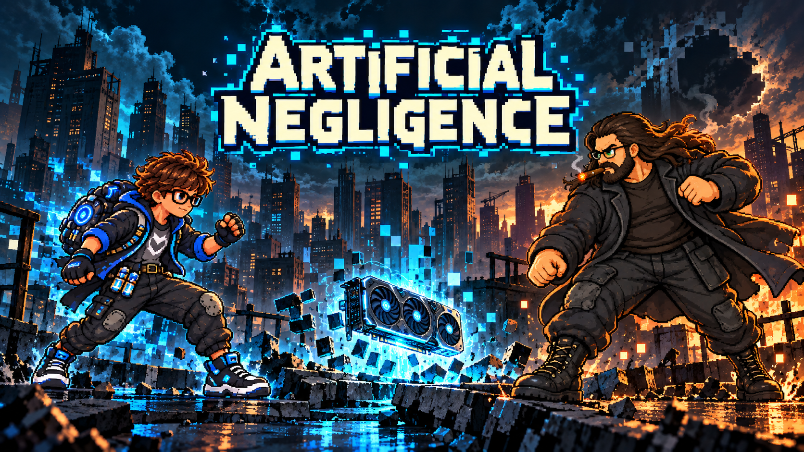
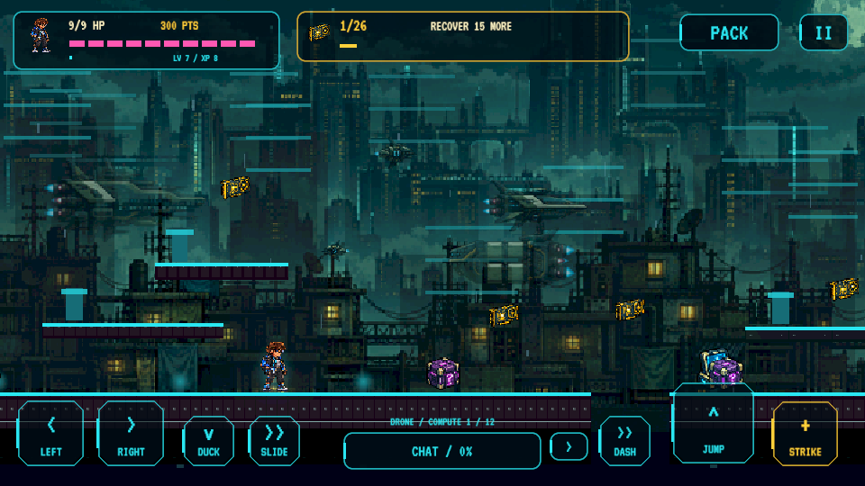
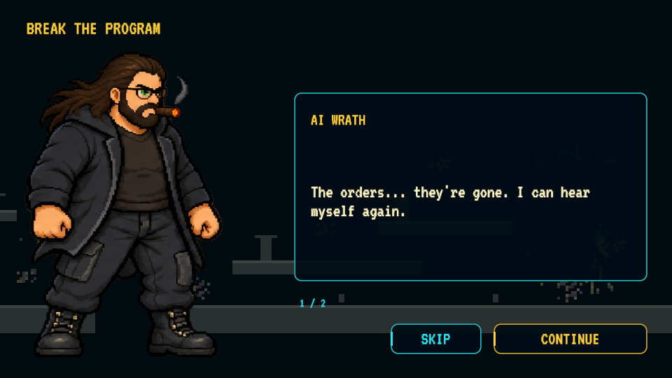
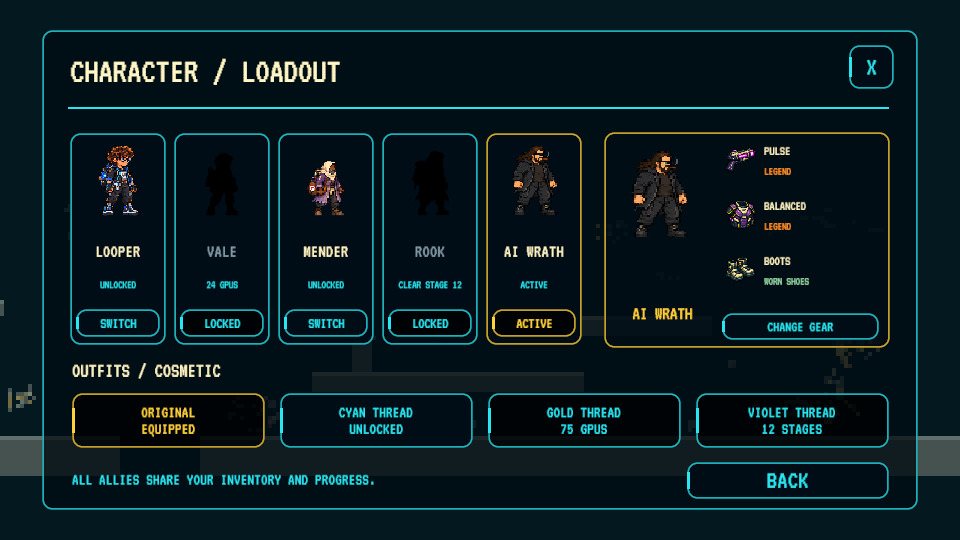
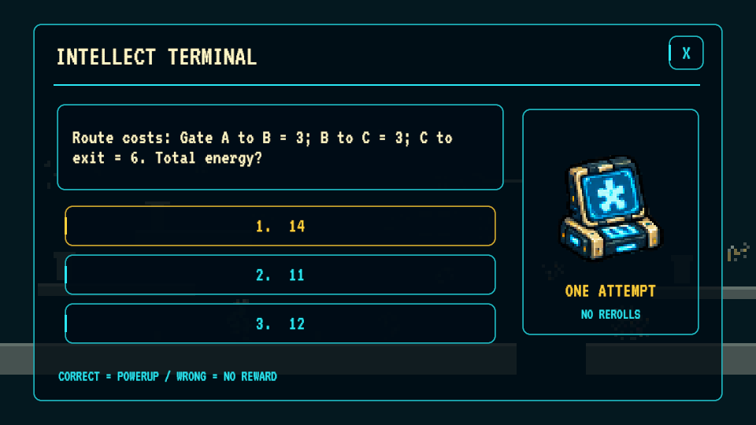

  

<h3 align="center">Restore reality. Keep AI public.</h3>

A story-driven 2D pixel platformer for Android and Windows.

  
  

  <a href="#new-in-this-update">What's new</a> · <a href="#screens-from-the-game">Screenshots</a> · <a href="#download-and-play">Install &amp; controls</a> · <a href="#creative-direction-and-ai-disclosure">AI disclosure</a> · <a href="STORY.md">Story</a>

v2.4.1 · Playtest build · Android 8+ ARM64 · Windows 64-bit

## The world broke. Take it back.

The global AI explosion gave ordinary people freedom. The corporations fought to reclaim it, hoarding GPUs and reserving intelligence for the elite. Their control system glitched reality itself: color disappeared, motion lost its frames, and whole neighborhoods fell into crude pixels.

You are **Looper**. Recover the GPUs, restore the world, and keep AI in the hands of the people. Cross the city, find your equipment, and confront **the Sinister**—human agents and bots enforcing corporate control.

The story continues through a first-run opening, short skippable artwork scenes, and occasional checkpoint transmissions. **Ai Wrath** begins as a Sinister elite. Break him free of the program, and he becomes an ally you can play. [Read the campaign outline](STORY.md).

---

## New in this update

- **Duck and slide:** move through low maintenance passages with a smaller collision shape.
- **Earn AI help:** defeats and close calls build momentum. With a full meter and enough compute, ask chat for a temporary drone, bridge, or shield.
- **Pursuing agents:** Sinister Marshals, Handlers, and Stalkers chase and fight with AI support.
- **Ai Wrath:** a new encounter, liberation scene, and gameplay-earned character unlock.
- **Story artwork:** original character illustrations accompany brief dialogue.
- **More presence:** higher detail pixel sprites, richer platform textures, and three additional gameplay music tracks.

## Screens from the game

These are actual Windows captures. The banner above is promotional artwork.

| Platforming at HD Pixel detail | Ai Wrath's liberation |
| --- | --- |
|  |  |

| Character and loadout | Found-item inventory |
| --- | --- |
|  |  |

| Live start screen | Intellect terminal |
| --- | --- |
|  |  |

## Built around exploration and choice

### Run, jump, restore

Explore **30 generated stages across five districts**, followed by further cycles of increasing resistance. Varied platform surfaces, stacked ledges, ground gaps, rooftop climbs, hazards, checkpoints, low passages, and airborne GPUs give each route a different rhythm. Route validation covers **60 routes, 1,960 GPUs, and 443 ground gaps**, using base movement and ducking for low routes without equipment upgrades.

Distinct GPUs permanently improve the world's graphics:

**Bootstrap → 8-bit → 16-bit → Neon → HD Pixel → Ultra**

Revisited districts keep your earned visual quality. Recollecting the same core does not grant duplicate restoration credit. Each pickup also adds to a **separate compute bank** for temporary AI support; spending compute never reduces visual restoration. Chat support must be earned through momentum, and taking damage drains that meter.

### Find your build

**You start unarmed and unarmored.** Strike at close range until you find a weapon. Supply boxes contain individual equipment finds, including multiple copies and different rarities. Equipment never auto-equips, and XP never grants weapons or armor.

| Weapon | Strength | Tradeoff |
| --- | --- | --- |
| Pulse | Balanced fire | Shields resist it |
| Arc | Shield breaking and chaining | Weaker against heavy armor |
| Scatter | Spread against swarms | Short range |
| Rail | Piercing and armor damage | Weaker against shields |

Balanced, Kinetic, Insulated, and Light armor provide different protection and movement tradeoffs. Keep finds in the inventory, equip deliberately, and spend points to improve equipment you own. Personal upgrades and talents add longer-term progression.

**Common → Rare → Epic → Legend → Ultra**

The workshop upgrades owned equipment through Legend. **Ultra is found only in boxes, with a 0.5% chance per box.**

### Unlock the resistance

Looper is available from the start. Unlock **Vale** with 24 distinct GPUs, **Mender** by clearing stage 6, **Rook** by clearing stage 12, and **Ai Wrath** by freeing him from the Sinister program. Locked characters appear as silhouettes; the character screen shows the selected character, outfit, and equipped items.

Characters currently share combat stats and inventory. Individual signature powers remain part of the [roadmap](ROADMAP.md).

### Outthink the Sinister

Twelve puzzle families offer changing intellect terminals. Each terminal allows one attempt; a wrong answer gives no powerup. Bots, pursuing human agents, and the Auditor, Harvester, and Executor bosses test your movement and equipment choices.

Choose **Relaxed, Standard, Hard, or Adaptive**. Adaptive increases pressure after strong clears and eases it after struggling clears or defeat; adjustments apply between stages.

## Download and play

- **[Android APK](https://github.com/dustindwayne/artificial-negligence/releases/latest/download/ArtificialNegligence.apk):** Android 8.0+, ARM64. Install over the existing app to retain local progress. Android asks you to approve installation.
- **[Windows ZIP](https://github.com/dustindwayne/artificial-negligence/releases/latest/download/ArtificialNegligence-Windows.zip):** extract the entire archive, then run `ArtificialNegligence.exe`. Keep the Data folder and supporting files beside it. The optional HD preview launcher changes rendering only and grants no progress.

Older saves from the menu-granted loadout system have that equipment cleared on migration, with a local backup saved as `progress-before-loot-inventory`. Levels, GPU restoration, and character progress are preserved.

### Controls

| Action | Windows | Android |
| --- | --- | --- |
| Move | A / D or arrows | Left / right |
| Jump | Space, W, or Up | Jump |
| Duck | S / Down | Duck |
| Slide while moving | Ctrl | Slide |
| Strike / equipped weapon | J / F | Strike / Fire |
| Dash | Shift / K | Dash |
| Earned AI assist / type | R / Q | Chat / type |
| Intellect terminal | E | Connect prompt |
| Inventory | I / G | Pack |
| Character / upgrades | C / U | Pause menu |
| Pause | Escape | Pause |
| Story: continue / skip | Space or Enter / Escape | Continue / Skip |

### Updates

On Android, use **Settings → Check for Updates**. The updater reuses matching regions from the installed APK, downloads missing regions in parallel, verifies the completed package, and hands installation to Android. Actual savings depend on what changed; unchanged music and art can be reused. Small balance updates can arrive separately.

The current APK is hosted once in GitHub Releases. [`apk/`](apk/) provides its link and update manifest. One v2.3.0 bridge remains for older clients. Windows updates are full ZIP downloads.

---

## Creative direction and AI disclosure

**Creator and creative director: Dustin (dustindwayne).** The original game concept, world, gameplay vision, art-style direction, and overall creative direction are his ideas. He supplied the music and visual references and directed the work.

**AI was used to build this game.** Codex/ChatGPT assisted with programming, generated visual assets, implementation, integration, and testing. This is an AI-assisted playtest build, not a claim of entirely hand-coded or hand-drawn production.

The art roadmap moves toward creator-drawn characters and key poses, with AI assisting animation frames under the creator's review. [Credits and disclosure](CREDITS.md) · [Art roadmap](ROADMAP.md) · [Banner generation record](docs/banner-generation-v241.md).

## Development and testing

Open [`unity/`](unity/) in **Unity 6000.6.5f1** with Android Build Support. `BuildGame.Desktop` and `BuildGame.Android` run puzzle, collection, rarity, sprite-gutter, and route validation before packaging.

Windows runtime checks cover the opening, dialogue completion and replay prevention, inventory, character locks, graphics tiers, upgrades, terminals, bosses, music rotation, and Ai Wrath's hostile encounter, liberation, and playable unlock. Android package metadata and signing are checked separately; a physical Android device playtest has not been performed for this release.

[Changelog](CHANGELOG.md) · [Story](STORY.md) · [Report a problem](https://github.com/dustindwayne/artificial-negligence/issues)
