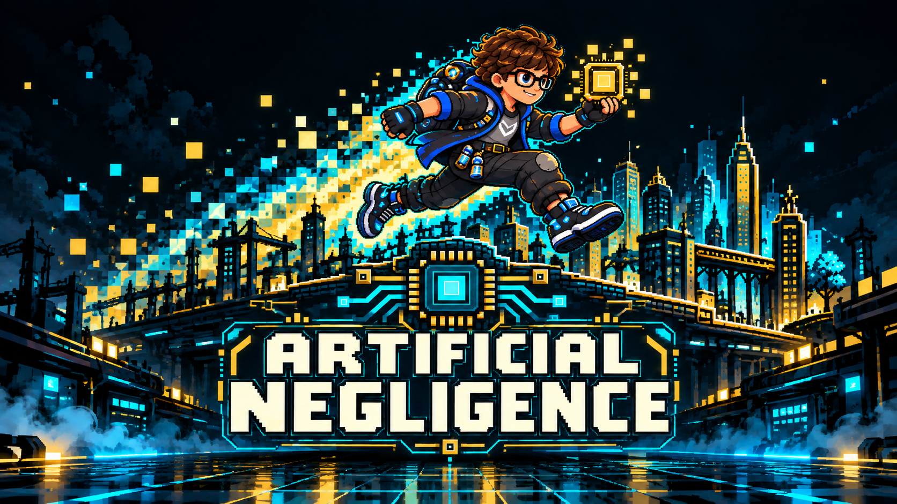
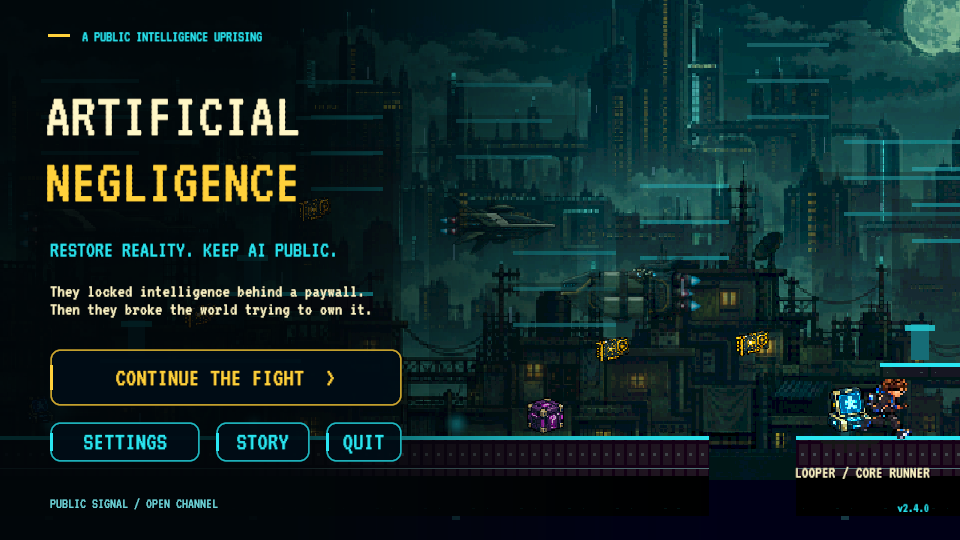
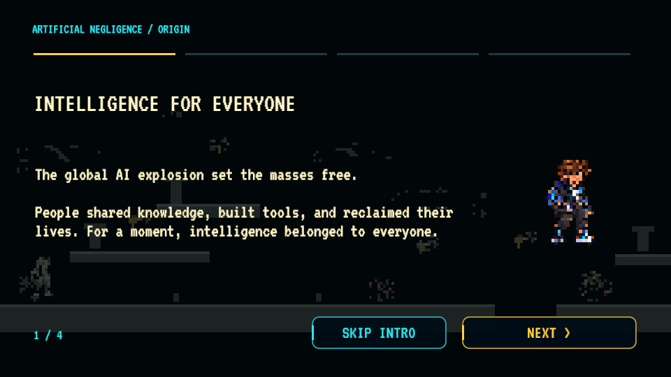
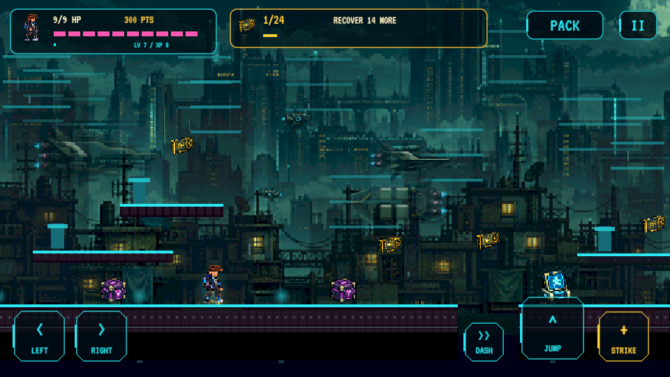
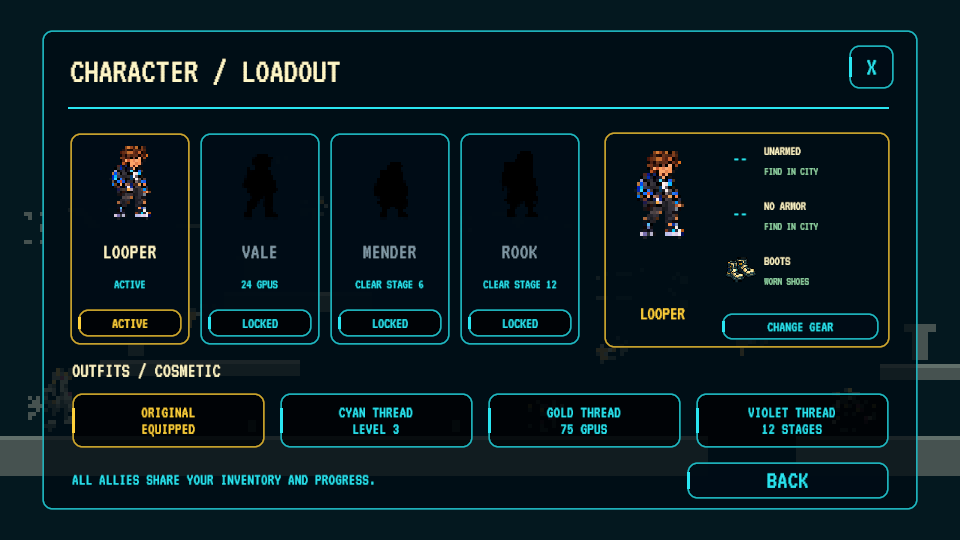

  

<strong>Restore reality. Keep AI public.</strong>

A 2D pixel platformer for Android and Windows.

  <a href="https://github.com/dustindwayne/artificial-negligence/releases/latest/download/ArtificialNegligence.apk"><strong>Android APK</strong></a> ·
  <a href="https://github.com/dustindwayne/artificial-negligence/releases/latest/download/ArtificialNegligence-Windows.zip"><strong>Windows ZIP</strong></a> ·
  <a href="STORY.md">Story</a> · <a href="ROADMAP.md">Roadmap</a> · <a href="CREDITS.md">Credits</a>

v2.4.0 · Android 8+ / ARM64 · Windows 64-bit · Unity 6000.6.5f1 · Playtest build

## The story

The global AI explosion set the masses free. People shared knowledge, built tools, and reclaimed their lives. The corporations tried to take it back, seizing GPUs and reserving intelligence for the elite.

Their takeover glitched reality itself. Color vanished, animation lost frames, and neighborhoods collapsed into crude pixels.

You are **Looper**, a core runner reconnecting a public network. Recover GPUs to restore the world and keep AI in the hands of the people. Find allies, salvage equipment, and fight your way through the city to the corporate uplinks.

**The first run begins with a four-part story opening.** Advance at your own pace or skip it; replay it using **Story** on the start screen. [Read the full campaign outline](STORY.md).

## Play your way

- **Platforming and exploration:** 30 generated stages across five city districts, with further cycles of increasing resistance. Narrow catwalks, broad rooftops, stacked ledges, taller climbs, gaps, checkpoints, hazards, and optional moving lifts vary the route.
- **Jump for the reward:** airborne GPUs sit above ledges and over gaps. All generated landings, GPUs, and ground gaps are checked with the base jump across 60 routes; no equipment or jump boost is required for reachability.
- **Find your equipment:** start unarmed and unarmored. Strike at close range until you find a weapon. Open supply boxes to collect individual weapons and armor pieces; XP never grants equipment.
- **An actual inventory:** keep multiple copies, including different rarities of the same type. Equip each find deliberately; stronger loot never auto-equips and weaker copies are retained.
- **Permanent growth:** GPUs and combat earn points and XP. Spend points on personal upgrades and improve equipment you own. Talents support weapon mastery and defense training.
- **Changing terminals:** twelve puzzle families, one attempt per terminal, and no powerup for a wrong answer.
- **Security and bosses:** scouts, gunners, chargers, shields, swarms, and snipers; rotating Auditor, Harvester, and Executor bosses with telegraphed attacks.
- **Adaptive difficulty:** choose Relaxed, Standard, Hard, or Adaptive. Adaptive raises pressure after strong clears and eases it after repeated hits or defeat; encounter adjustments apply between stages.
- **A living start screen:** moving city traffic, an animated Looper, and transmissions introduce the fight.

## Equipment and allies

| Weapon family | Strength | Tradeoff |
| --- | --- | --- |
| Pulse | Balanced fire | Shields resist it |
| Arc | Breaks shields and chains between enemies | Weaker against heavy armor |
| Scatter | Spread against swarms | Short range |
| Rail | Piercing and armor damage | Weaker against shields |

Balanced, Kinetic, Insulated, and Light armor offer different protection and movement tradeoffs. Each found copy keeps its own **Common → Rare → Epic → Legend → Ultra** tier. The workshop improves equipped, owned items through Legend. **Ultra is found only in boxes, with a 0.5% chance per box.**

Looper is available from the start. Unlock **Vale** with 24 distinct GPUs, **Mender** by clearing stage 6, and **Rook** by clearing stage 12. The character screen shows locked silhouettes, the selected character, equipped gear, and outfit unlocks. Characters currently share combat stats and inventory; their proposed signature powers are described in the story outline and are not yet implemented.

## Restore the world's graphics

Distinct GPU cores permanently upgrade visual quality through **Bootstrap → 8-bit → 16-bit → Neon → HD Pixel → Ultra**. Revisited districts use your earned graphics tier. Collecting the same core again does not grant duplicate restoration credit.

The restoration is part of the story: every recovered core returns compute to the public and repairs reality. Platform collision and jump physics stay consistent throughout.

## Screenshots

| Start screen | Story opening |
| --- | --- |
|  |  |

| Platforming | Character and equipment |
| --- | --- |
|  |  |

## Download and play

**[Android APK](https://github.com/dustindwayne/artificial-negligence/releases/latest/download/ArtificialNegligence.apk)** — Android 8.0+, ARM64. Open the APK on your device and approve installation. Install over the existing app to retain local progress.

**[Windows ZIP](https://github.com/dustindwayne/artificial-negligence/releases/latest/download/ArtificialNegligence-Windows.zip)** — extract the entire archive, then run `ArtificialNegligence.exe`. Keep the Data folder and supporting files beside it.

Older saves from the menu-granted equipment system have that loadout cleared when migrated. A backup is retained locally as `progress-before-loot-inventory`; player levels, GPU restoration, and character unlocks are preserved. Newly found items use the individual inventory system.

### Controls

| Action | Android | Windows |
| --- | --- | --- |
| Move | Left / right pads | A / D or arrows |
| Jump | Jump | Space, W, or Up |
| Strike / fire equipped weapon | Strike / Fire | J or F |
| Dash | Dash | Shift or K |
| Terminal | Connect prompt | E |
| Inventory | Pack / pause menu | I or G |
| Character | Pause → Character | C |
| Upgrades | Pause → Upgrades | U |
| Pause | Pause | Escape |
| Story page | Next | Space / Enter |

### In-app updates

Use **Settings → Check for Updates** on Android. The updater reuses matching regions from the installed APK, downloads missing data in parallel, verifies the rebuilt APK, and hands installation to Android. Download size depends on the changes; unchanged music and art can be reused. Installation still requires Android approval.

The current APK is hosted once in GitHub Releases. [`apk/`](apk/) contains its download link and region manifest. One v2.3.0 bridge is retained so older clients can reach the current updater. Windows updates are distributed as a complete ZIP.

## Creative direction and AI use

**Dustin (dustindwayne)** created the game concept, world, art-style direction, gameplay vision, and overall creative direction, and supplied music and visual references. This build uses AI assistance for programming, generated artwork, integration, and testing. [Full disclosure and credits](CREDITS.md).

The art roadmap moves toward creator-drawn characters and key poses, with AI assisting animation frames under the creator's review. [Art roadmap](ROADMAP.md) · [Logo record](docs/logo-generation.md) · [Sprite record](docs/sprite-refresh.md).

## Development

Open [`unity/`](unity/) in Unity **6000.6.5f1** with Android Build Support. Build methods are `BuildGame.Desktop` and `BuildGame.Android`. Both run gameplay and base-jump route validation before packaging. Runtime `-qa` checks cover the opening, interface, collection, graphics tiers, upgrades, puzzles, movement, and bosses.

[Changelog](CHANGELOG.md) · [Report a problem](https://github.com/dustindwayne/artificial-negligence/issues)
