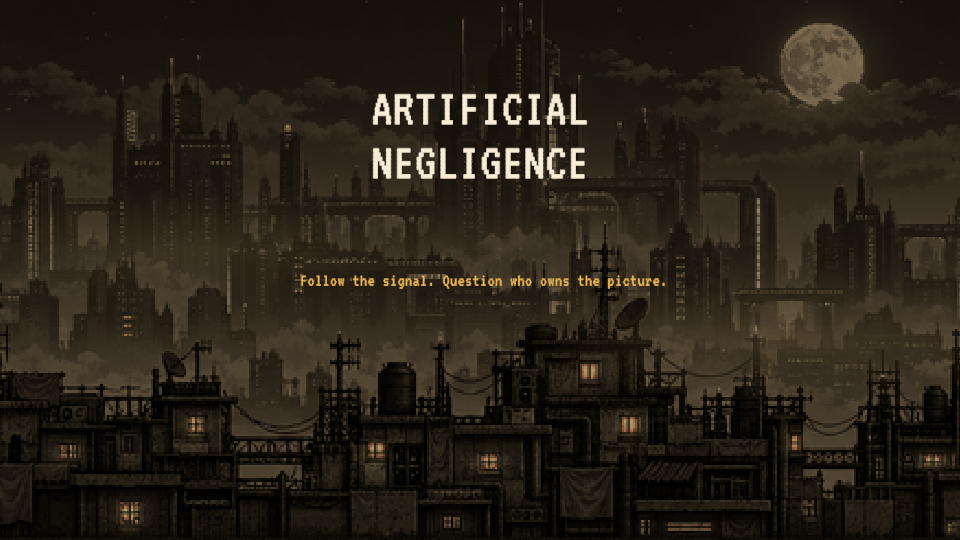
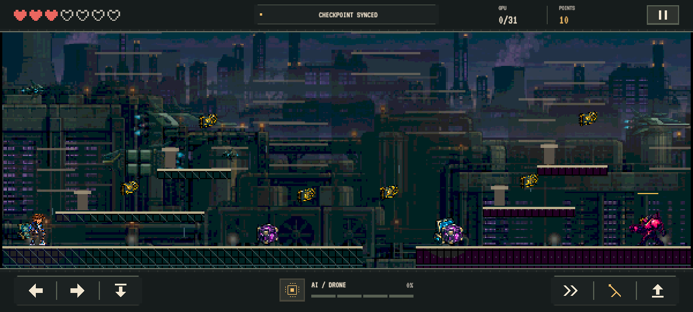
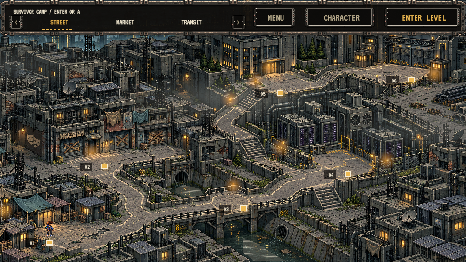
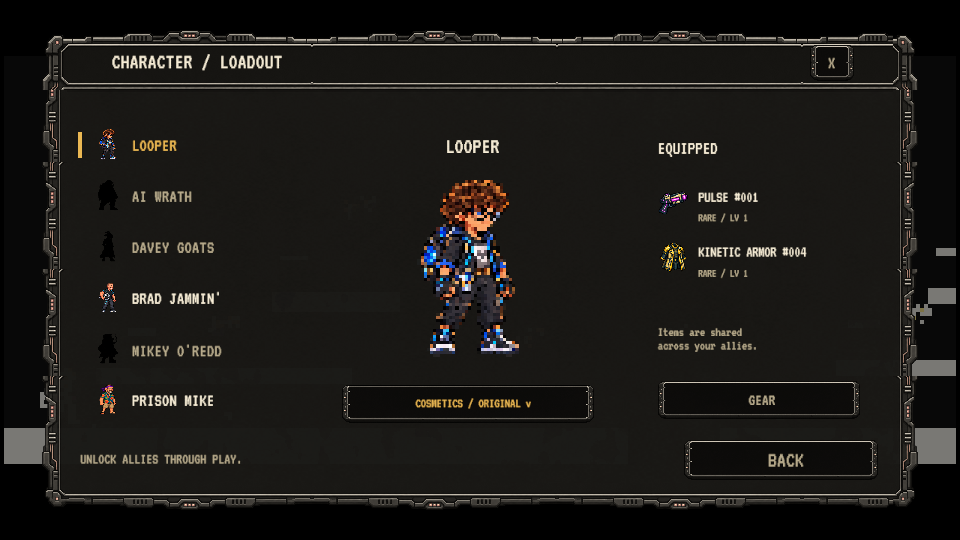
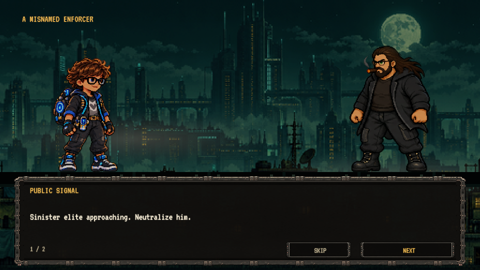
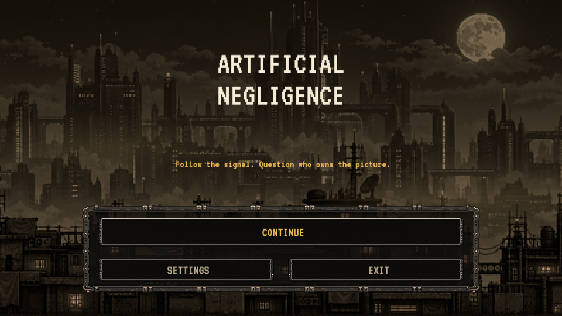
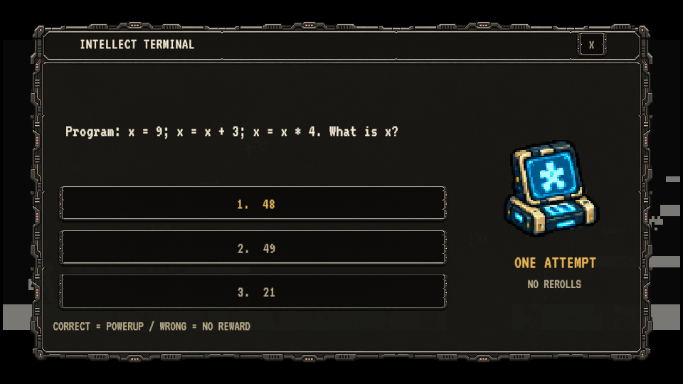

  

<h3 align="center">Restore reality. Keep AI public.</h3>

A story-driven 2D pixel platformer for Android, Windows, Linux and your browser.

Find Android, Windows, Linux and WebGL downloads on the <a href="https://github.com/dustindwayne/artificial-negligence/releases/latest">latest release page</a>.

<a href="https://dustinwann.com/apps/artificial-negligence/">Play in your browser</a>

v2.5.1 · Playtest build · Android 8+ ARM64 · Windows x64 · Linux x64

## The world broke. Take it back.

The AI boom opened new possibilities. Then reality fractured into crude pixels. The Public Signal blames a masked group outsiders call **Sinister** and asks you to recover the GPUs.

You are **Looper**. Cross the city, find allies and equipment, and sharpen the world one core at a time. Follow the signal—but question who owns the picture. Short artwork scenes and radio dialogue carry a three-act story about freedom, deception and restoring humanity.

## New in 2.5.1

- The first supply box gives you a weapon and the second gives you armor. Each new find equips immediately. Open **Gear** on the HUD to switch back to a previous item or **Upgrades** to improve your equipment.
- The first three stages have fewer regular enemies. Enemy difficulty ramps up through stage six.
- Click an unlocked map entrance to walk there and start playing. The Enter Level button and controller confirmation are also available.

## Meet the resistance

| Character | Unlock |
| --- | --- |
| **Looper** | Available from the start |
| **Davey Goats** | Defeat his virtual-world encounter in stage 18 |
| **Brad Jammin’** | Clear stage 6 |
| **Prison Mike** | Clear stage 12 |
| **Ai Wrath** | Defeat his third encounter in stage 13, following encounters in stages 6 and 12 |
| **Mikey O’Redd** | Defeat his virtual-world encounter in stage 9 |

Locked characters appear as silhouettes. Characters share progress, inventory and combat systems; distinct signature powers remain a future goal.

## See the game

The banner is captured from the title screen with the menu buttons hidden. The images below are from the Windows build of **2.5.0**.

| Platforming and the new HUD | Walking district map |
| --- | --- |
|  |  |

| Character and loadout | Story dialogue |
| --- | --- |
|  |  |

| Main menu | Intellect terminal |
| --- | --- |
|  |  |

## Play your way

### Restore the world

Explore **90 generated stages across three acts**, using five district themes and continuing into harder free-roam cycles after the finale. These are procedurally assembled routes, not 90 handcrafted environments. Stacked ledges, ground gaps, rooftop climbs, hazards, checkpoints, low passages and airborne GPUs reward movement and exploration.

Distinct GPUs permanently improve the graphics:

**Bootstrap → 8-bit → 16-bit → Neon → HD Pixel → Ultra**

GPUs also fill a separate compute bank. Earn momentum through combat and close calls to request temporary AI help. Spending compute does not reduce restored graphics; taking damage drains momentum.

### Find your equipment

**You start unarmed and unarmored.** Find equipment in supply boxes, equip each pickup immediately, and keep earlier finds in your inventory.

| Weapon | Role | Tradeoff |
| --- | --- | --- |
| Pulse | Balanced fire | Shields resist it |
| Arc | Shield breaking and chaining | Weaker against heavy armor |
| Scatter | Crowd control | Short range |
| Rail | Piercing and armor damage | Weaker against shields |

Balanced, Kinetic, Insulated and Light armor offer different protection and movement tradeoffs. Spend points on owned equipment, personal upgrades and talents.

**Common → Rare → Epic → Legend → Ultra**

Upgrade individual found items with **points and salvage**. Rarity never changes through upgrades. Item level caps are Common 5, Rare 6, Epic 7, Legend 8 and Ultra 10. Salvage spare unequipped items; equipped items are protected.

**Ultra has a 0.5% supply-box chance.** An excellent clear also awards one equipment item: **5% Ultra / 10% Legend / 85% Rare**. Collect at least 95% of the stage’s GPUs, take no hits or falls, and defeat any required boss. Each distinct stage grants this bonus once. The reward equips immediately.

### Survive the city

Twelve puzzle families keep intellect terminals varied. Each terminal gives one attempt; wrong answers give no powerup. Human agents pursue you, bots pressure your route and bosses test movement and equipment choices.

Choose **Relaxed, Standard, Hard or Adaptive**. Adaptive adjusts pressure between stages based on how you play.

## Download and play

Find **Android, Windows, Linux and WebGL** downloads, installation details and release notes on the **[latest release page](https://github.com/dustindwayne/artificial-negligence/releases/latest)**.

You can also **[play in your browser](https://dustinwann.com/apps/artificial-negligence/)**.

Progress saves locally on each platform; saves do not sync between devices or the browser.

### Controls

| Action | Keyboard | Android |
| --- | --- | --- |
| Move | A / D or arrows | Left / right |
| Jump | Space, W or Up | Jump |
| Duck / moving slide | S / Down · Ctrl | Hold Down / press while moving |
| Equipped weapon fire | J / F | Fire, after finding a weapon |
| Dash | Shift / K | Dash |
| Earned AI help / type | R / Q | AI Help / Menu → AI Type |
| Terminal | E | Nearby Interact |
| Inventory / character / upgrades | I or G / C / U | Menu |
| Pause | Escape | Menu |

Windows supports Xbox/XInput-compatible controllers; Linux supports Unity Input System gamepads with the same action mapping; web supports standard-mapped browser gamepads. **A** jumps/confirms, **X/RT** attacks, **B** slides/backs out, **RB** dashes and **Menu** pauses. [Full controls and compatibility](docs/CONTROLS.md).

### Updates

Android: **Settings → Check for Updates**. Downloads reuse matching installed/cached regions where possible and verify the completed APK before handing installation to Android. Download the current package for Windows or Linux. Browser updates arrive when the hosting files are replaced. [Update details](docs/UPDATES.md).

## Development and testing

Open [`unity/`](unity/) in **Unity 6000.6.5f1** with Windows, Linux Mono, Android and WebGL modules. Build methods validate puzzles, equipment rules, sprite gutters and generated routes before packaging. Automated route checks cover all **90 generated routes**, including GPUs, supply boxes, and ground gaps. Uplink approaches reserve a 180-pixel GPU-free zone. Automated checks do not replace human balance testing; physical controller compatibility and in-app Android installation remain to be tested.

[Testing and compatibility](docs/TESTING.md) · [Changelog](CHANGELOG.md) · [Story](STORY.md) · [Report a problem](https://github.com/dustindwayne/artificial-negligence/issues)
