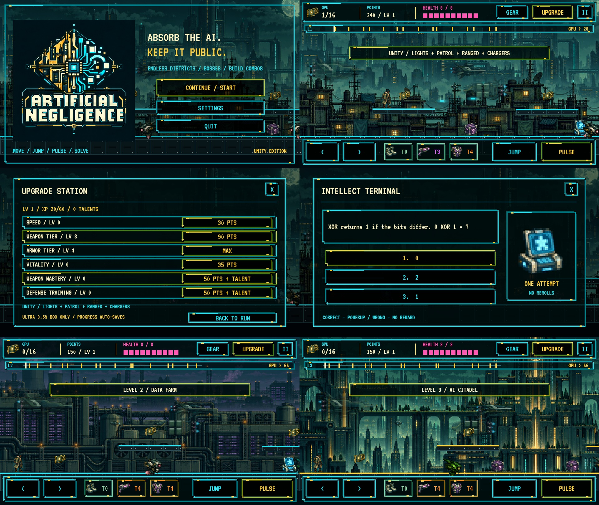

# Artificial Negligence

Absorb the AI. Keep it public.

**Creative direction, original concept and art-style direction: Dustin (dustindwayne). This is an AI-assisted build, including programming and generated visual assets. [Full credits and disclosure](CREDITS.md).**

A neon pixel platformer for Android: collect GPUs, solve changing logic puzzles, defeat corporate security and bosses, and build a character with weapons, armor, modules and permanent upgrades.

## Download the latest Android game

**[Download latest APK](https://raw.githubusercontent.com/dustindwayne/artificial-negligence/main/apk/ArtificialNegligence-latest.apk)**

[Browse the APK folder](apk/) · [Latest version details](apk/latest.json)

Android 8.0 or newer, ARM64. Download the APK, open it on your phone and approve installation. This is a testing build signed with the same key across these published versions. Install over your existing copy to keep local progress.

## In-app updates

Version 1.3 introduces **Settings > Check for Updates**. When an update is available, tap Download Update, then Install Update. Android may ask you to allow this game to install updates; after allowing it, return and tap Install Update again.

The updater scans the installed APK and reuses matching content chunks. Only missing chunks are downloaded, so unchanged music and artwork can be reused. Resumable chunk downloads and SHA-256 checks verify the reconstructed APK before Android verifies its signing key and asks you to install it. Download size depends on what changed; this is not a promise of zero music bytes for every build. Version 1.2 and earlier require one full download to gain this updater.

## Art direction roadmap

The planned direction is to replace fully generated visuals with creator-drawn characters and key poses, using AI to assist individual animation frames. [Read the art roadmap](ROADMAP.md).

## Gameplay

- A connected city map with 30 generated stages across five districts, then further city cycles.
- Two-tier rooftops, dash, checkpoints, optional moving lifts, timed hazards and mastery stars.
- Layered city scenery, rain, foreground detail and a new animated enemy/boss atlas.
- Scouts, gunners, chargers, Aegis shields, swarms and snipers.
- Rotating Auditor, Harvester and Executor bosses with telegraphed attacks and enraged phases.
- XP leveling, talents, points, speed, vitality, weapon mastery and defense training.
- Pulse, Arc, Scatter and Rail weapons; four armor styles; three modules with combat tradeoffs.
- Common through Ultra gear. Ultra remains exclusive to boxes with exactly a 0.5% chance per box.
- Twelve logic-puzzle families, interactive circuits and answer explanations; wrong submissions give no powerup.
- Six compressed music tracks for menus, gameplay, upgrades, bosses, victory and game over.
- Local progress saving; offline play except update checks and downloads.




## Source and publishing updates

Open `unity/` with Unity 6000.6.5f1 and Android Build Support. See [Unity project documentation](unity/README.md). Keep the signing key private and use the same key for updates. Increase the Android version code for each release.

After building, run:

```sh
python tools/publish_apk.py /path/to/game.apk --version 1.3.0 --code 130
```

Then commit and push the updated `apk/` folder. Its stable download link always points to the newest APK; the manifest and chunk files support the in-app updater. The publisher is local and does not push or require a GitHub token. Keep existing chunk files so users downloading an earlier manifest can finish.

Reachability, progression, puzzle rules, loadout counters and desktop gameplay were checked. Physical Android installation/update testing is still required.

### Art direction roadmap

The planned direction is to replace fully generated visuals with creator-drawn characters and key poses, using AI to assist individual animation frames. [Read the art roadmap](ROADMAP.md).

## Gameplay-only updates

Settings checks `apk/gameplay.json` for newer balance settings. Enemy health, boss health, enemy speed/damage, weapon damage and XP can be updated as a tiny JSON download; no APK install and no music/art download is required. Values are validated and saved for offline play. New enemy health applies when a district starts.

To publish a balance change without rebuilding:

```sh
python tools/publish_gameplay.py --version 2 --enemyHealth 1.1 --xp 1.1 --notes "Tougher enemies with more XP."
```

Commit and push `apk/gameplay.json`. New executable features still require an APK update; unchanged APK chunks are reused where possible.


## GPU-powered graphics progression (2.1)

Collecting distinct GPUs permanently rebuilds the world's renderer. Graphics upgrades happen automatically and do not spend points or affect collision geometry. Replaying an already credited GPU gives its usual gameplay reward but cannot farm graphics progression.

| Absorbed GPUs | Renderer | World resolution | Visual changes |
| --- | --- | --- | --- |
| 0 | Bootstrap | 240 x 135 | Coarse pixels, four-tone city, clear danger/objective accents |
| 24 | 8-bit | 320 x 180 | Color returns and background city layers appear |
| 75 | 16-bit | 400 x 225 | Finer colors, additional depth and initial bloom |
| 150 | Neon | 480 x 270 | Stronger lighting, weather and richer effects |
| 300 | HD Pixel | 720 x 405 | More detail, weather and particles |
| 600 | Ultra | 960 x 540 | Full color and the richest lighting/effects |

Controls, text and menus remain clear at every tier. The art stays a pixel-art platformer; higher tiers reveal more detail in the existing artwork. GPU identities and renderer progression save with the character and survive restarts. Existing saves retain gameplay progress; distinct graphics-core tracking begins with this version.

The progression concept and creative direction came from Dustin. AI assisted implementation, consistent with the project's credits and artist-led art roadmap.

Preview captures show the same scene with test GPU totals for each renderer tier.


