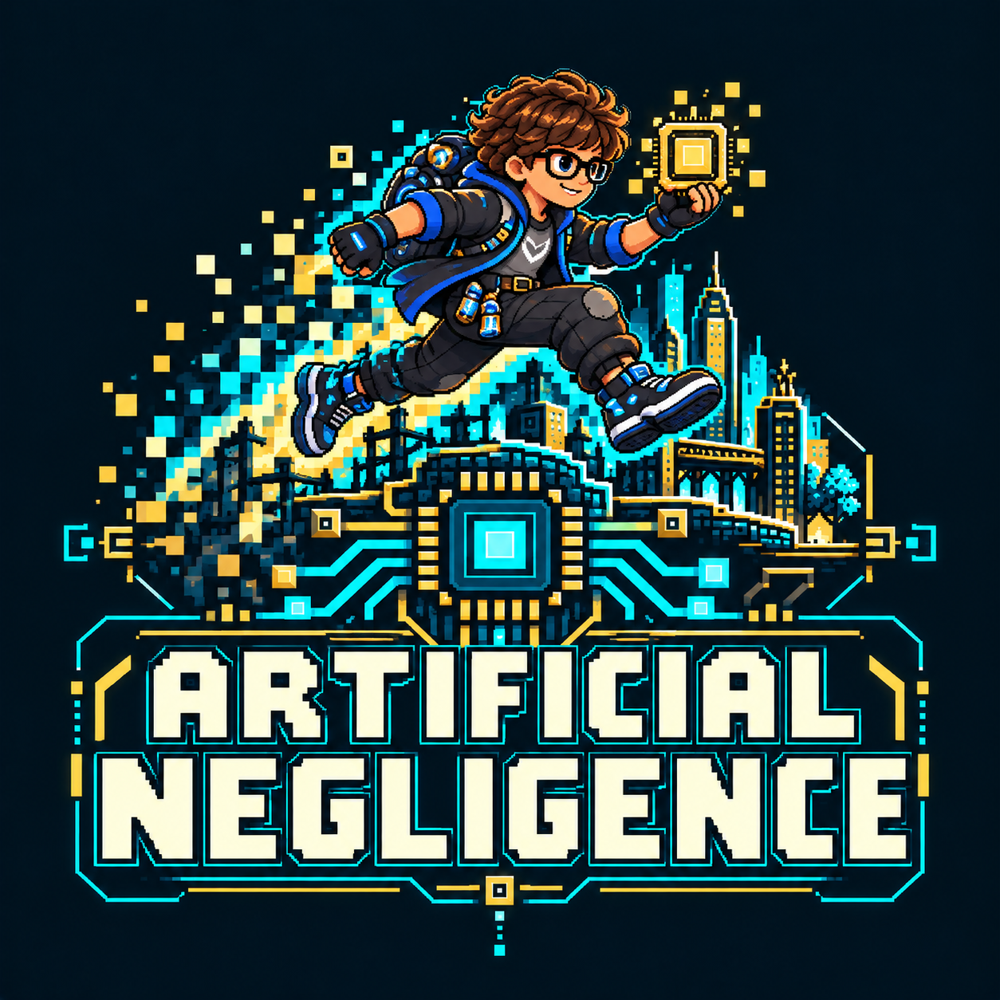
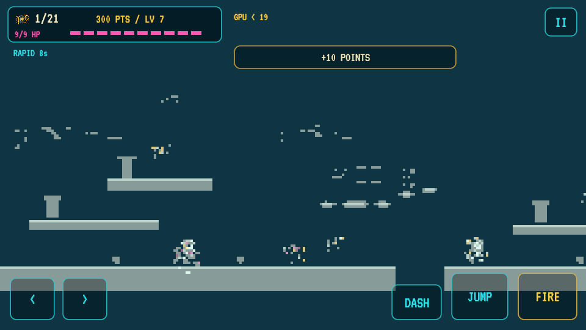
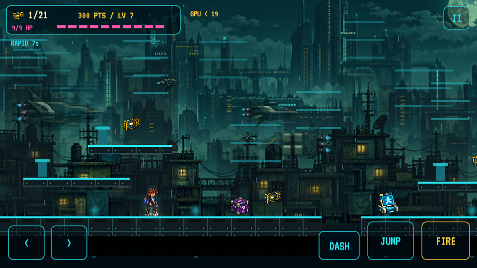
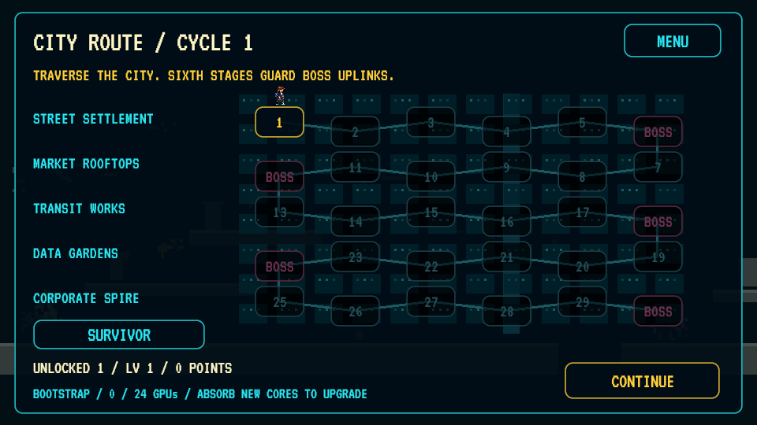
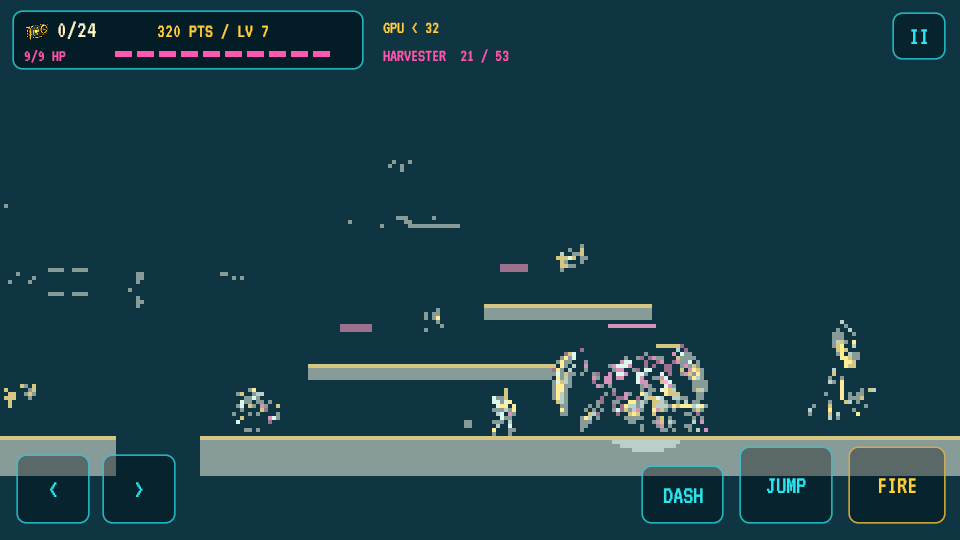
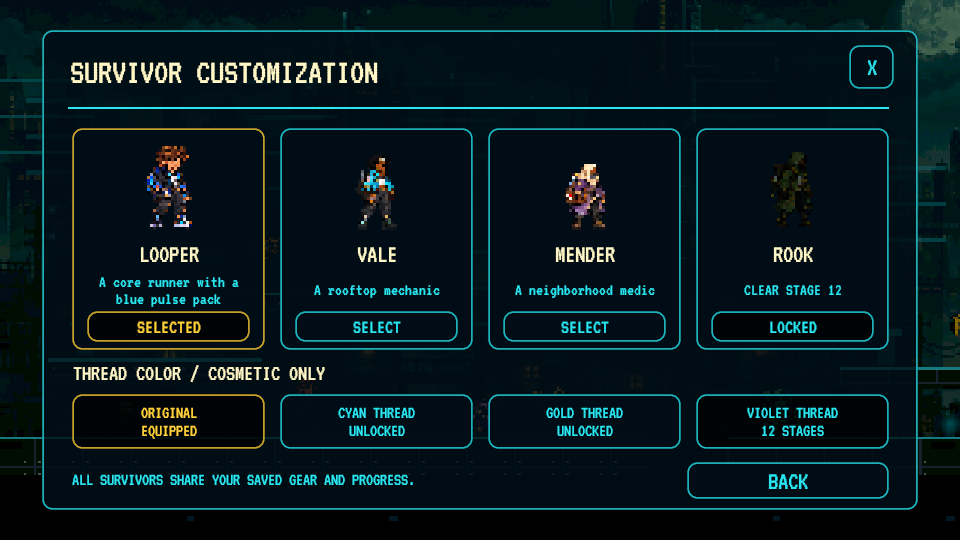
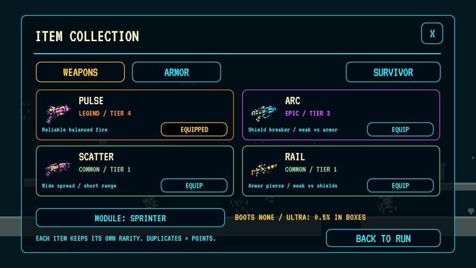

  

<strong>Absorb the AI. Keep it public.</strong>

An Android pixel platformer where collecting GPUs upgrades the world itself.

  <a href="https://raw.githubusercontent.com/dustindwayne/artificial-negligence/main/apk/ArtificialNegligence-latest.apk"><strong>Download APK</strong></a> ·
  <a href="#screenshots">Screenshots</a> ·
  <a href="ROADMAP.md">Art roadmap</a> ·
  <a href="CREDITS.md">Credits</a>

v2.2.0 · Android 8+ · ARM64 · Unity 6000.6.5f1 · Playtest build

## Overview

**Artificial Negligence** is a single-player 2D platformer for Android, built in Unity.

Start as **Looper**, a core runner collecting GPUs before corporations seize them. Unlock more survivors as you cross the city. Fight through rooftop routes, solve intellect terminals and reach district bosses. Every core helps reclaim public AI—and brings more color, detail and depth to the world.

## Features

- **A connected city:** 30 generated stages across five districts, followed by further city cycles with increasingly tough enemies.
- **Platforming routes:** six route motifs vary platform spacing, rooftops, loot, terminals, enemy encounters and hazards. Dash, checkpoints and optional moving lifts support exploration.
- **Enemies with presence:** six enemy classes, animated attacks and three rotating bosses.
- **Build your survivor:** permanent XP, talents and upgrades; Pulse, Arc, Scatter and Rail weapons with armor and module tradeoffs.
- **A persistent collection:** discover weapons and armor with their own Common–Ultra rarities, equip combinations and salvage duplicates. Ultra equipment has a 0.5% chance in boxes.
- **Gameplay character unlocks:** Looper starts unlocked; collect 24 distinct GPUs for Vale, clear stage 6 for Mender and stage 12 for Rook. Thread colors unlock through leveling, cores and stage clears.
- **A quieter HUD:** compact status, contextual messages and translucent thumb controls; secondary progress stays in pause and inventory.
- **Changing logic puzzles:** twelve puzzle families, explanations after answers and no powerup for a wrong answer.

## How a run works

1. Pick a stage on the city map and explore ground routes and rooftops.
2. Collect GPUs for points and XP; open boxes for equipment and temporary boosts.
3. Solve intellect terminals for extra powerups. Each terminal allows one attempt.
4. Reach the uplink with at least 60% of the stage’s GPUs. Boss stages also require defeating the boss.
5. Spend points, improve your build and move to the next route. Full GPU clears earn three mastery stars.

Character, collection, XP and graphics progress save locally. Revisit stages for points and loot; graphics progression requires distinct cores.

## Combat and equipment

| Weapon | Strength | Tradeoff |
| --- | --- | --- |
| Pulse | Balanced fire | Shields resist it |
| Arc | Breaks shields; chains to nearby enemies | Less effective against heavy armor |
| Scatter | Wide spread against swarms | Short range |
| Rail | Armor damage and piercing | Less effective against shields |

Balanced, Kinetic, Insulated and Light armor change protection and movement. Sprinter, Capacitor and Stabilizer modules complement different builds. Items keep their own rarity: **Common → Rare → Epic → Legend → Ultra**. Find stronger drops, salvage duplicates or spend points to improve the equipped item through Legend. Ultra is found in boxes only.

## Graphics are progression

Distinct GPUs permanently improve the renderer. Upgrades are automatic; points remain available for character upgrades. Replaying an already credited GPU still awards gameplay rewards, but does not advance graphics again.

| GPUs collected | Graphics tier | World resolution |
| ---: | --- | --- |
| 0 | Bootstrap | 240 × 135 |
| 24 | 8-bit | 320 × 180 |
| 75 | 16-bit | 400 × 225 |
| 150 | Neon | 480 × 270 |
| 300 | HD Pixel | 720 × 405 |
| 600 | Ultra | 960 × 540 |

The pixel-art style stays consistent as color, scenery, lighting and weather become richer. Menus and controls stay sharp throughout; collision geometry stays consistent.

## Screenshots

<table>
<tr><th>Bootstrap graphics</th><th>Ultra graphics</th></tr>
<tr><td></td><td></td></tr>
<tr><th>City route</th><th>Boss encounter</th></tr>
<tr><td></td><td></td></tr>
<tr><th>Survivor unlocks</th><th>Equipment collection</th></tr>
<tr><td></td><td></td></tr>
</table>

Screenshots come from the desktop test build. Graphics comparisons and unlock screens use staged progress.

## Play on Android

1. [Download the latest APK](https://raw.githubusercontent.com/dustindwayne/artificial-negligence/main/apk/ArtificialNegligence-latest.apk).
2. Open it on an Android 8.0+ ARM64 device and approve installation.
3. Install over an existing compatible copy to keep local progress.

This is a testing build. Checks cover 1,509 GPUs and 443 gaps across the first 60 generated routes, all 88 active sprite frames, collection rules and save migration; desktop gameplay and the HUD have been checked. Physical Android installation and update testing remains outstanding.

### Updates

Open **Settings → Check for Updates**. APK updates reuse matching installed content chunks, reducing downloads when music and artwork are unchanged. Android asks you to approve installation. Small balance updates can download separately without reinstalling the APK.

[Update and publishing guide](docs/UPDATES.md) · [APK folder](apk/) · [Current version manifest](apk/latest.json) · [Changelog](CHANGELOG.md)

## Controls

| Action | Android | Keyboard |
| --- | --- | --- |
| Move | Left / right | A / D or arrow keys |
| Jump | Jump | Space, W or Up |
| Dash | Dash | Left Shift or K |
| Fire | Fire | J or F |
| Solve terminal | Nearby Solve prompt | E |
| Gear / upgrades | Pause → Gear / Upgrades | G / U |
| Pause | Top-right pause button | Escape |

Choose characters from **City Map → Survivor** or **Pause → Gear → Survivor**. Characters and thread colors are cosmetic and share your saved build.

## Creative direction and AI use

**Dustin (dustindwayne)** created the concept, art-style direction, world, gameplay vision and overall creative direction, and supplied music and visual references. This build uses AI assistance for programming, generated artwork, integration and testing. [Full credits and disclosure](CREDITS.md).

The art roadmap moves toward creator-drawn characters and key poses, with AI assisting animation frames under the creator’s review. [Read the roadmap](ROADMAP.md). The new emblem combines the survivor, GPU collection and the city’s transition from coarse pixels to richer detail. [Logo generation record](docs/logo-generation.md) · [Sprite refresh and prompt record](docs/sprite-refresh.md).

## Development

Open `unity/` in **Unity 6000.6.5f1** with Android Build Support. [Project setup and controls](unity/README.md).

| Folder | Contents |
| --- | --- |
| `unity/` | Editable Unity project and game source |
| `apk/` | Latest public APK, update manifests and reusable chunks |
| `docs/` | Screenshots, branding and release documentation |
| `tools/` | APK and balance-update publishing scripts |

Report problems through [GitHub Issues](https://github.com/dustindwayne/artificial-negligence/issues), including your device, Android version, game version and steps to reproduce.
