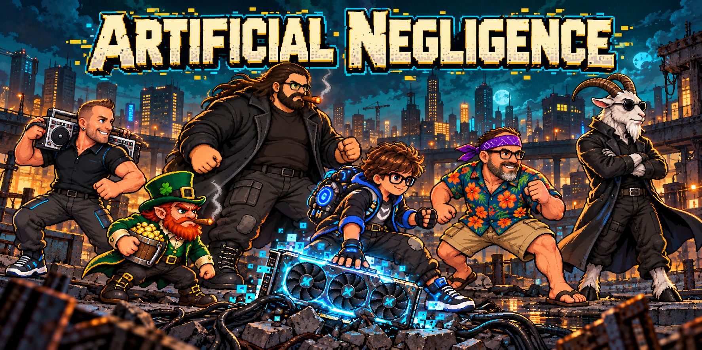
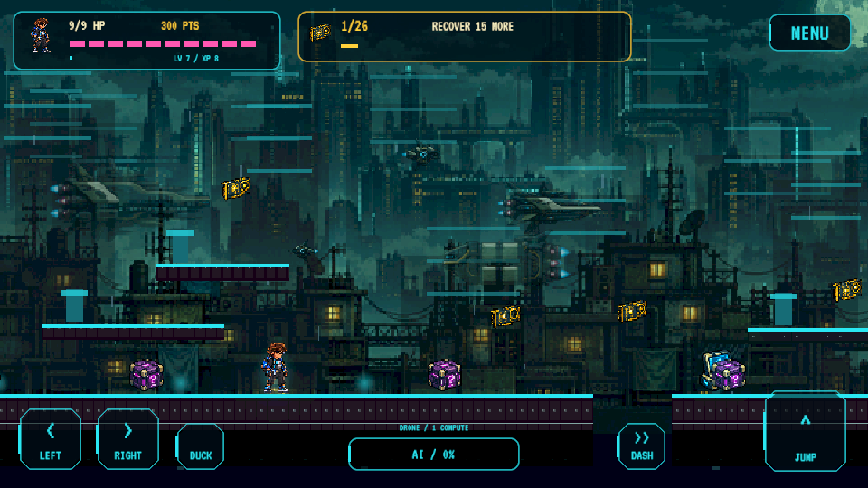
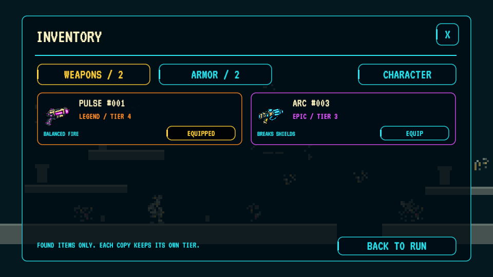
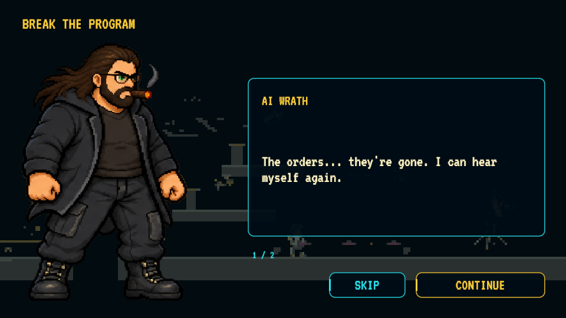
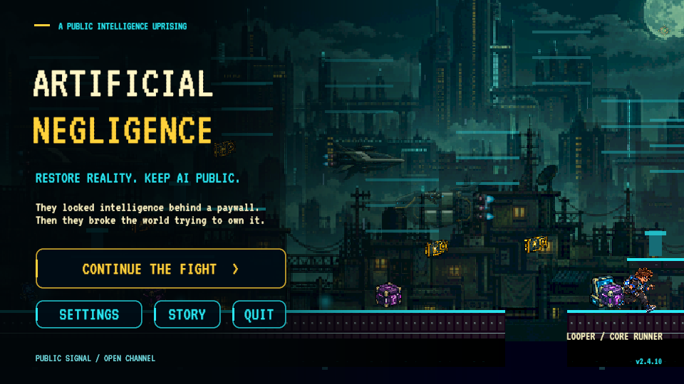

  

<h3 align="center">Restore reality. Keep AI public.</h3>

A story-driven 2D pixel platformer for Android, Windows and your browser.

  
  

<a href="https://dustinwann.com/apps/artificial-negligence/">Play in your browser</a> · <a href="https://github.com/dustindwayne/artificial-negligence/releases/latest/download/ArtificialNegligence-Web-FTP.zip">WebGL package</a> · <a href="https://github.com/dustindwayne/artificial-negligence/releases/tag/v2.4.10">Release notes</a>

v2.4.10 · Playtest build · Android 8+ ARM64 · Windows x64

## The world broke. Take it back.

The global AI explosion set ordinary people free. Corporations tried to seize the GPUs and reserve intelligence for the elite. Their control system glitched reality into crude pixels.

You are **Looper**. Cross the city, recover the GPUs, restore the world and return AI to the people. The **Sinister** send bots, pursuing human agents and bosses to stop you. Short artwork scenes and checkpoint dialogue carry the story through the campaign. Ai Wrath begins as an enemy; breaking his program brings him into the resistance.

## New in this build

- **Prison Mike:** purple bandana, Hawaiian shirt, khaki shorts and flip-flops, with eight animation poses.
- **Gameplay unlocks:** Davey Goats joins at 24 distinct GPUs, Brad Jammin’ after stage 6 and Prison Mike after stage 12.
- **Six-character cast:** a readable roster beside a large active preview, equipped-item details and an in-preview cosmetics dropdown.
- **New ensemble artwork:** the banner above features the complete current cast. Screens below are captures from this build.

## Meet the resistance

| Character | Unlock |
| --- | --- |
| **Looper** | Available from the start |
| **Davey Goats** | Collect 24 distinct GPUs |
| **Brad Jammin’** | Clear stage 6 |
| **Prison Mike** | Clear stage 12 |
| **Ai Wrath** | Defeat his third encounter in stage 13, following encounters in stages 6 and 12 |
| **Mikey O’Redd** | Enter `mikeyredd` in the hidden signal decoder |

Locked characters appear as silhouettes. Characters share progress, inventory and combat systems; distinct signature powers remain a future goal. Existing earned unlocks are preserved.

## See the game

The banner is AI-generated promotional art. These are actual Windows captures from **2.4.10**.

| Platforming at HD Pixel detail | Current character and loadout screen |
| --- | --- |
|  |  |

| Found-item inventory | Story scene |
| --- | --- |
|  |  |

| Animated start screen | Intellect terminal |
| --- | --- |
|  |  |

## Play your way

### Restore the world

Explore **30 generated stages across five districts**, then continue into harder city cycles. Stacked ledges, ground gaps, rooftop climbs, hazards, checkpoints, low passages and airborne GPUs reward movement and exploration.

Distinct GPUs permanently improve the graphics:

**Bootstrap → 8-bit → 16-bit → Neon → HD Pixel → Ultra**

GPUs also fill a separate compute bank. Earn momentum through combat and close calls to request temporary AI help. Spending compute does not reduce restored graphics; taking damage drains momentum.

### Find your equipment

**You start unarmed and unarmored.** Find equipment in supply boxes, keep individual copies and equip them deliberately from the inventory. Items do not auto-equip; XP does not grant weapons or armor.

| Weapon | Role | Tradeoff |
| --- | --- | --- |
| Pulse | Balanced fire | Shields resist it |
| Arc | Shield breaking and chaining | Weaker against heavy armor |
| Scatter | Crowd control | Short range |
| Rail | Piercing and armor damage | Weaker against shields |

Balanced, Kinetic, Insulated and Light armor offer different protection and movement tradeoffs. Spend points on owned equipment, personal upgrades and talents.

**Common → Rare → Epic → Legend → Ultra**

The workshop improves owned equipment through Legend. **Ultra equipment is found only in boxes, with a 0.5% chance per box.**

### Outsmart the Sinister

Twelve puzzle families keep intellect terminals varied. Each terminal gives one attempt; wrong answers give no powerup. Human agents pursue you, bots pressure your route and bosses test movement and equipment choices.

Choose **Relaxed, Standard, Hard or Adaptive**. Adaptive adjusts pressure between stages based on how you play.

## Download and play

- **[Android APK](https://github.com/dustindwayne/artificial-negligence/releases/latest/download/ArtificialNegligence.apk):** Android 8+, ARM64. Install over the existing app to retain local progress.
- **[Windows ZIP](https://github.com/dustindwayne/artificial-negligence/releases/latest/download/ArtificialNegligence-Windows.zip):** extract the complete archive and run `ArtificialNegligence.exe`. Keep its Data folder and supporting files alongside it.
- **[WebGL package](https://github.com/dustindwayne/artificial-negligence/releases/latest/download/ArtificialNegligence-Web-FTP.zip):** browser game and hosting files. [Hosting guide](docs/WEB-HOSTING.md).

Progress saves locally. Android, Windows and browser saves do not sync.

### Controls

| Action | Keyboard | Android |
| --- | --- | --- |
| Move | A / D or arrows | Left / right |
| Jump | Space, W or Up | Jump |
| Duck / moving slide | S / Down · Ctrl | Hold Down / press while moving |
| Equipped weapon fire | J / F | Fire, after equipping a find |
| Dash | Shift / K | Dash |
| Earned AI help / type | R / Q | AI Help / Menu → AI Type |
| Terminal | E | Nearby Interact |
| Inventory / character / upgrades | I or G / C / U | Menu |
| Pause | Escape | Menu |

Windows supports Xbox/XInput-compatible controllers; web supports standard-mapped browser gamepads. **A** jumps/confirms, **X/RT** attacks, **B** slides/backs out, **RB** dashes and **Menu** pauses. [Full controls and compatibility](docs/CONTROLS.md).

### Updates

Android: **Settings → Check for Updates**. Downloads reuse matching installed/cached regions where possible and verify the completed APK before handing installation to Android. Windows uses the latest ZIP; browser updates arrive when the hosting files are replaced. [Update details](docs/UPDATES.md).

## Creative direction and AI disclosure

**Creator and creative director: Dustin Wann (dustindwayne).** The original concept, world, gameplay vision, art direction, music selection and character ideas are his direction.

**AI was used to build this game.** Codex/ChatGPT assisted with programming, generated artwork, implementation, integration and testing. This is an AI-assisted playtest build. The art roadmap moves toward creator-drawn characters and key poses, with AI assisting frames under creator review.

[Credits](CREDITS.md) · [Art roadmap](ROADMAP.md) · [Current banner generation record](docs/cast-banner-generation-v250.md)

## Development and testing

Open [`unity/`](unity/) in **Unity 6000.6.5f1** with the relevant platform modules. Build methods validate puzzles, equipment rules, sprite gutters and generated routes before packaging. Automated route checks cover **60 routes, 1,960 GPUs and 443 ground gaps**. Automated checks do not replace human balance testing; physical controller compatibility and in-app Android installation remain to be tested.

[Testing and compatibility](docs/TESTING.md) · [Changelog](CHANGELOG.md) · [Story](STORY.md) · [Report a problem](https://github.com/dustindwayne/artificial-negligence/issues)
