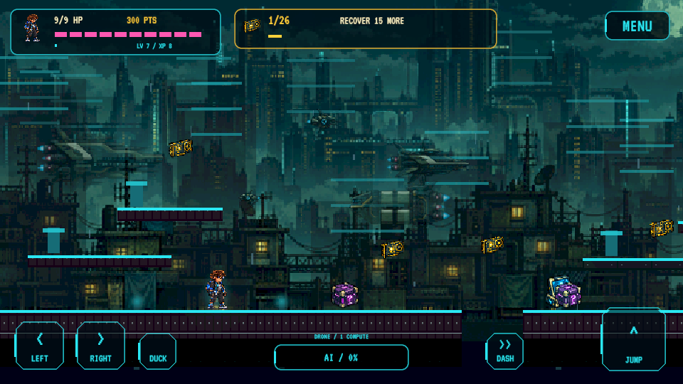
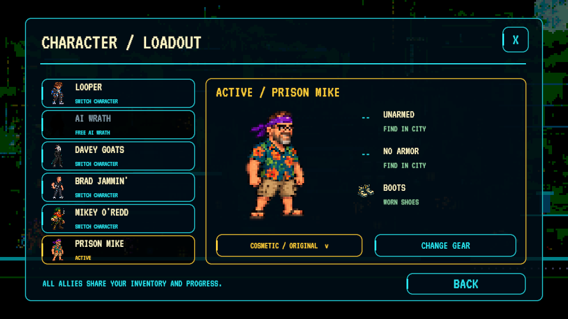
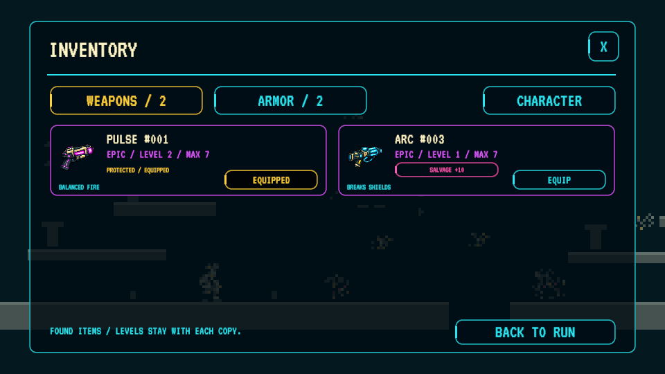
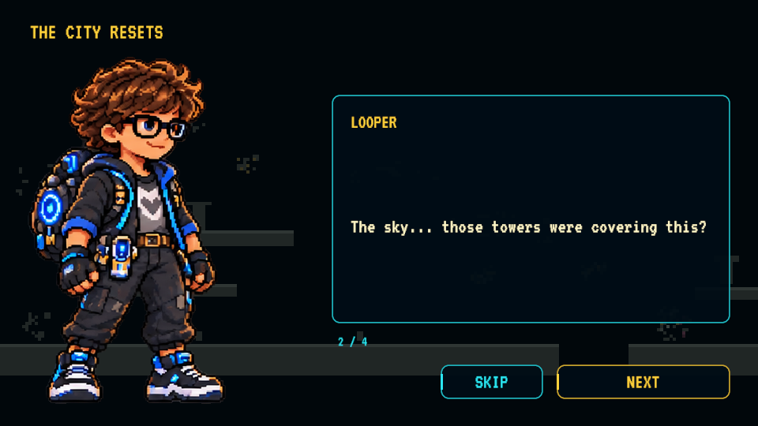
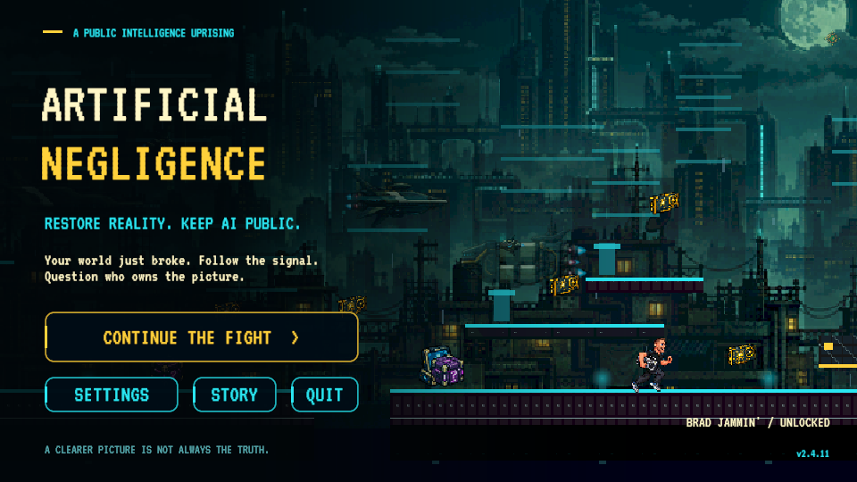
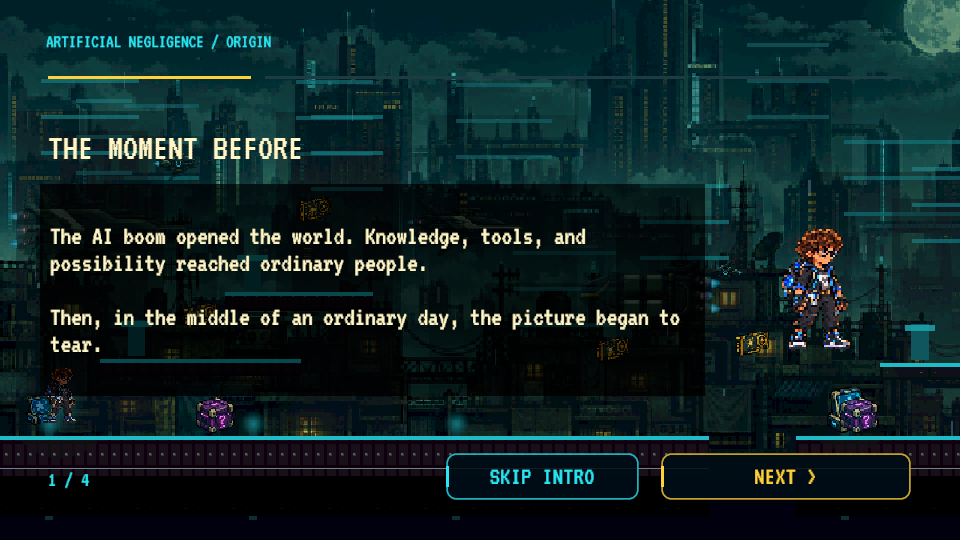
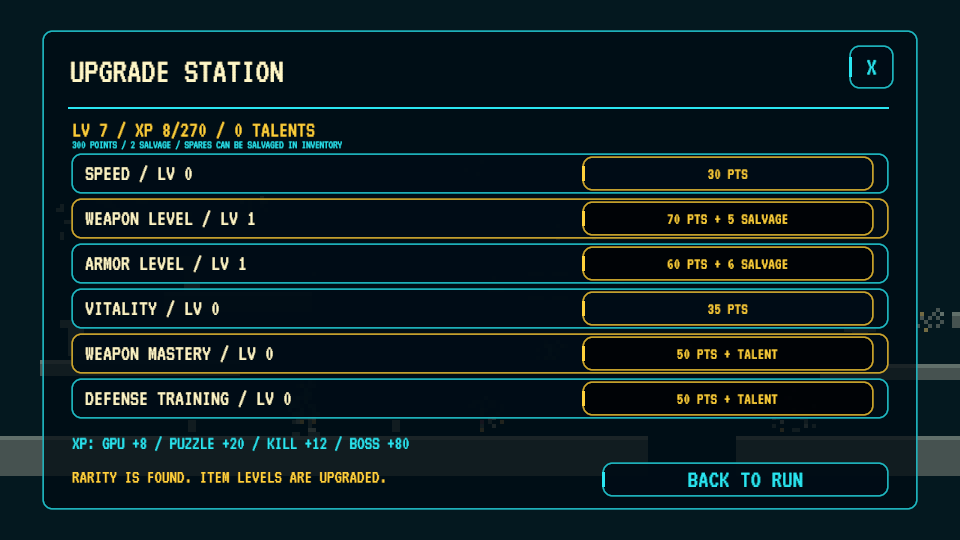

  

<h3 align="center">Restore reality. Keep AI public.</h3>

A story-driven 2D pixel platformer for Android, Windows, Linux and your browser.

  
  

<a href="https://dustinwann.com/apps/artificial-negligence/">Play in your browser</a> · <a href="https://github.com/dustindwayne/artificial-negligence/releases/latest/download/ArtificialNegligence-Linux.tar.gz">Linux download</a> · <a href="https://github.com/dustindwayne/artificial-negligence/releases/latest/download/ArtificialNegligence-Web-FTP.zip">WebGL package</a> · <a href="https://github.com/dustindwayne/artificial-negligence/releases/tag/v2.4.11">Release notes</a>

v2.4.11 · Playtest build · Android 8+ ARM64 · Windows x64 · Linux x64

## The world broke. Take it back.

The AI boom opened new possibilities. Then reality fractured into crude pixels. The Public Signal blames a masked group outsiders call **Sinister** and asks you to recover the GPUs.

You are **Looper**. Cross the city, find allies and equipment, and sharpen the world one core at a time. Follow the signal—but question who owns the picture. Short artwork scenes and radio dialogue carry a three-act story about freedom, deception and restoring humanity.

## New in this build

- **Linux desktop build:** a native x64 player alongside Windows, Android and web.

- **Three acts:** 90 generated stages, a city-reset reveal, the Unknown alliance and a restoration finale.
- **The Founder:** a new story portrait and leader of the Unknown. Every playable character has a role in the story.
- **Virtual-world recruits:** defeat Mikey O’Redd and Davey Goats to free them and make them playable.
- **Individual equipment levels:** improve found items with points and salvage. Rarity stays fixed; equip finds manually.
- **Excellent-clear loot:** a qualifying clear rolls 5% Ultra, 10% Legend and 85% Rare.
- **A visible beginning:** see the clear world fracture; the live title scene rotates through your unlocked cast.
- **Pickup placement:** generated routes check boxes and GPU reachability, with a GPU-free approach to each uplink.

## Meet the resistance

| Character | Unlock |
| --- | --- |
| **Looper** | Available from the start |
| **Davey Goats** | Defeat his virtual-world encounter in stage 18 |
| **Brad Jammin’** | Clear stage 6 |
| **Prison Mike** | Clear stage 12 |
| **Ai Wrath** | Defeat his third encounter in stage 13, following encounters in stages 6 and 12 |
| **Mikey O’Redd** | Defeat his virtual-world encounter in stage 9 |

Locked characters appear as silhouettes. Characters share progress, inventory and combat systems; distinct signature powers remain a future goal. Existing earned unlocks are preserved.

## See the game

The banner is AI-generated promotional art. These are actual Windows captures from **2.4.11**.

| Platforming at HD Pixel detail | Current character and loadout screen |
| --- | --- |
|  |  |

| Found-item inventory | Story scene |
| --- | --- |
|  |  |

| Animated start screen | Intellect terminal |
| --- | --- |
|  |  |

| Before the fracture | Item upgrade workshop |
| --- | --- |
|  |  |

## Play your way

### Restore the world

Explore **90 generated stages across three acts**, using five district themes and continuing into harder free-roam cycles after the finale. These are procedurally assembled routes, not 90 handcrafted environments. Stacked ledges, ground gaps, rooftop climbs, hazards, checkpoints, low passages and airborne GPUs reward movement and exploration.

Distinct GPUs permanently improve the graphics:

**Bootstrap → 8-bit → 16-bit → Neon → HD Pixel → Ultra**

GPUs also fill a separate compute bank. Earn momentum through combat and close calls to request temporary AI help. Spending compute does not reduce restored graphics; taking damage drains momentum.

### Find your equipment

**You start unarmed and unarmored.** Find equipment in supply boxes, keep individual copies and equip them deliberately from the inventory. Items do not auto-equip; XP does not grant weapons or armor.

| Weapon | Role | Tradeoff |
| --- | --- | --- |
| Pulse | Balanced fire | Shields resist it |
| Arc | Shield breaking and chaining | Weaker against heavy armor |
| Scatter | Crowd control | Short range |
| Rail | Piercing and armor damage | Weaker against shields |

Balanced, Kinetic, Insulated and Light armor offer different protection and movement tradeoffs. Spend points on owned equipment, personal upgrades and talents.

**Common → Rare → Epic → Legend → Ultra**

Upgrade individual found items with **points and salvage**. Rarity never changes through upgrades. Item level caps are Common 5, Rare 6, Epic 7, Legend 8 and Ultra 10. Salvage spare unequipped items; equipped items are protected.

**Ultra has a 0.5% supply-box chance.** An excellent clear also awards one equipment item: **5% Ultra / 10% Legend / 85% Rare**. Collect at least 95% of the stage’s GPUs, take no hits or falls, and defeat any required boss. Each distinct stage grants this bonus once. Rewards enter inventory without auto-equipping.

### Survive the city

Twelve puzzle families keep intellect terminals varied. Each terminal gives one attempt; wrong answers give no powerup. Human agents pursue you, bots pressure your route and bosses test movement and equipment choices.

Choose **Relaxed, Standard, Hard or Adaptive**. Adaptive adjusts pressure between stages based on how you play.

## Download and play

- **[Android APK](https://github.com/dustindwayne/artificial-negligence/releases/latest/download/ArtificialNegligence.apk):** Android 8+, ARM64. Install over the existing app to retain local progress.
- **[Windows ZIP](https://github.com/dustindwayne/artificial-negligence/releases/latest/download/ArtificialNegligence-Windows.zip):** extract the complete archive and run `ArtificialNegligence.exe`. Keep its Data folder and supporting files alongside it.
- **[Linux tar.gz](https://github.com/dustindwayne/artificial-negligence/releases/latest/download/ArtificialNegligence-Linux.tar.gz):** extract the archive, keep its files together and launch `ArtificialNegligence.x86_64`. Same content and controls as Windows; physical device/distribution compatibility still needs playtesting.
- **[WebGL package](https://github.com/dustindwayne/artificial-negligence/releases/latest/download/ArtificialNegligence-Web-FTP.zip):** browser game and hosting files. [Hosting guide](docs/WEB-HOSTING.md).

Progress saves locally. Android, Windows and browser saves do not sync.

### Controls

| Action | Keyboard | Android |
| --- | --- | --- |
| Move | A / D or arrows | Left / right |
| Jump | Space, W or Up | Jump |
| Duck / moving slide | S / Down · Ctrl | Hold Down / press while moving |
| Equipped weapon fire | J / F | Fire, after equipping a find |
| Dash | Shift / K | Dash |
| Earned AI help / type | R / Q | AI Help / Menu → AI Type |
| Terminal | E | Nearby Interact |
| Inventory / character / upgrades | I or G / C / U | Menu |
| Pause | Escape | Menu |

Windows supports Xbox/XInput-compatible controllers; Linux supports Unity Input System gamepads with the same action mapping; web supports standard-mapped browser gamepads. **A** jumps/confirms, **X/RT** attacks, **B** slides/backs out, **RB** dashes and **Menu** pauses. [Full controls and compatibility](docs/CONTROLS.md).

### Updates

Android: **Settings → Check for Updates**. Downloads reuse matching installed/cached regions where possible and verify the completed APK before handing installation to Android. Windows uses the latest ZIP; browser updates arrive when the hosting files are replaced. [Update details](docs/UPDATES.md).

## Creative direction and AI disclosure

**Creator and creative director: Dustin Wann (dustindwayne).** The original concept, world, gameplay vision, art direction, music selection and character ideas are his direction.

**AI was used to build this game.** Codex/ChatGPT assisted with programming, generated artwork, implementation, integration and testing. This is an AI-assisted playtest build. The art roadmap moves toward creator-drawn characters and key poses, with AI assisting frames under creator review.

[Credits](CREDITS.md) · [Art roadmap](ROADMAP.md) · [Current banner generation record](docs/cast-banner-generation-v250.md)

## Development and testing

Open [`unity/`](unity/) in **Unity 6000.6.5f1** with Windows, Linux Mono, Android and WebGL modules. Build methods validate puzzles, equipment rules, sprite gutters and generated routes before packaging. Automated route checks cover **90 generated routes, 2,945 GPUs and 666 ground gaps, with supply-box reachability and a 180-pixel GPU exclusion before uplinks**. Automated checks do not replace human balance testing; physical controller compatibility and in-app Android installation remain to be tested.

[Testing and compatibility](docs/TESTING.md) · [Changelog](CHANGELOG.md) · [Story](STORY.md) · [Report a problem](https://github.com/dustindwayne/artificial-negligence/issues)
