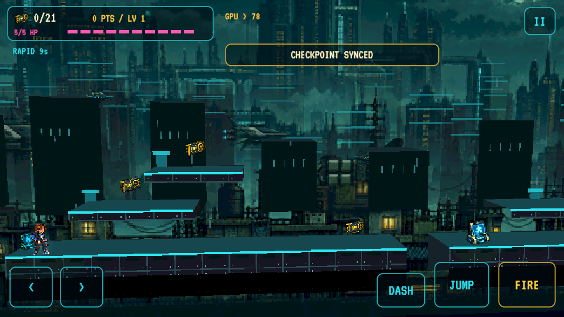

# Unity 2.5D desktop preview

This preview reuses the complete Unity platformer: generated routes, Looper and character unlocks, equipment rarities, upgrades, bosses, puzzles and music.

## New presentation
- Perspective camera with gentle downward and sideways viewing angles.
- Smooth horizontal tracking and velocity-based look-ahead.
- Vertical framing follows rooftop jumps; speed slightly widens the view.
- Platform roofs, side returns and rear walls add actual depth around the existing landing surfaces.
- Midground building facades, sides and rooftops separate the skyline from the playable lane.
- Original Physics2D movement and collision remain on one readable side-scrolling plane.

This is a Windows playtest of the 2.5D presentation. The published Android APK is still v2.3.0. The Godot global-clock and day/night sprite experiment has not been ported into this Unity preview.

## Controls
A/D or arrows: move; Space: jump; J/F: fire; Shift/K: dash; E: terminal; U: upgrades; G: gear; Escape: pause.

## Verification
Unity editor validation passed all 60 generated routes (1,509 GPUs, 443 gaps), puzzles, collection progression and sprite gutters. Runtime camera test passed perspective rendering, movement, camera travel and district transitions.

